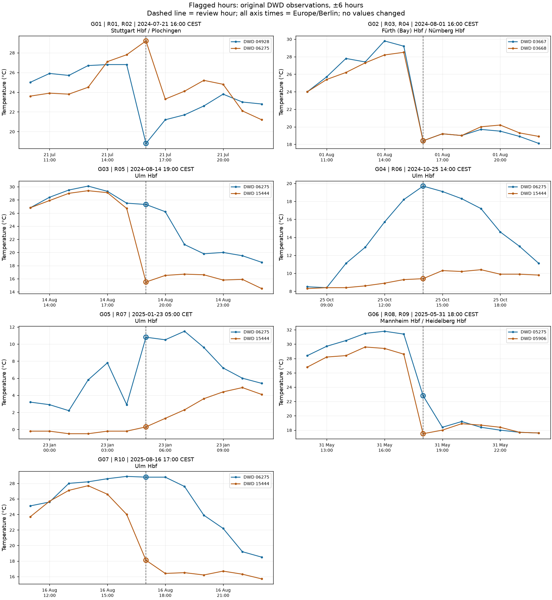
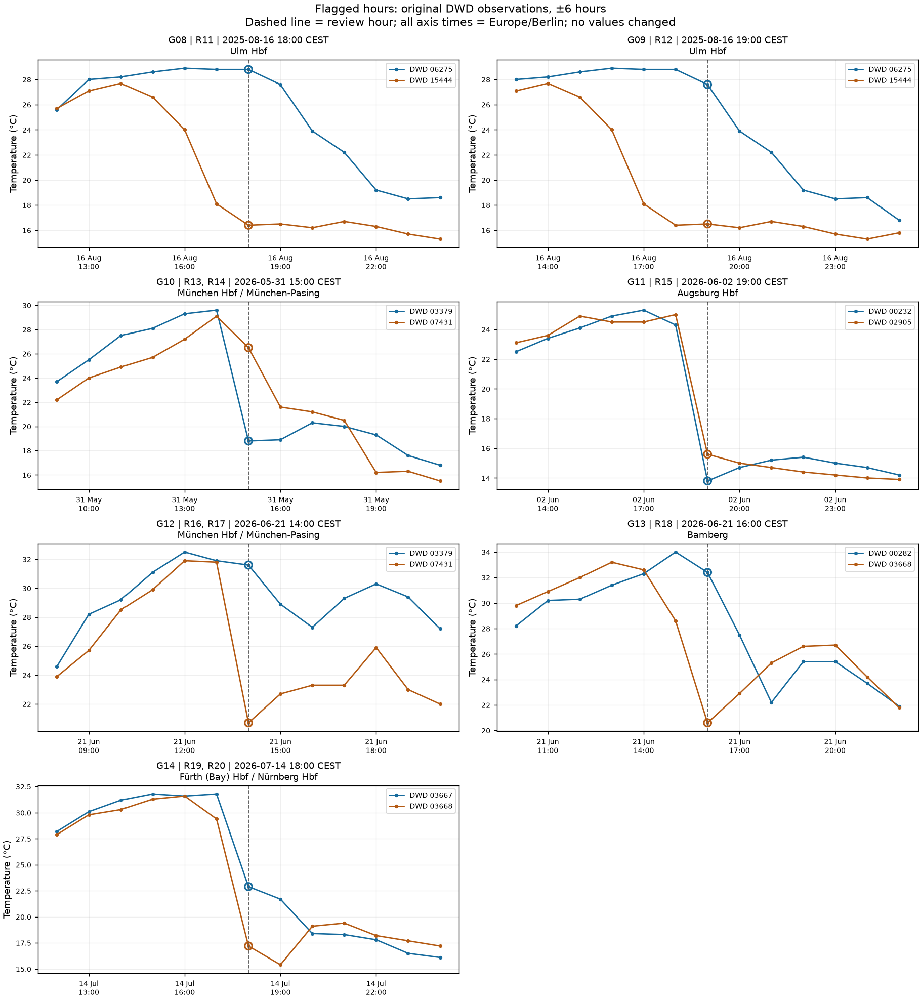
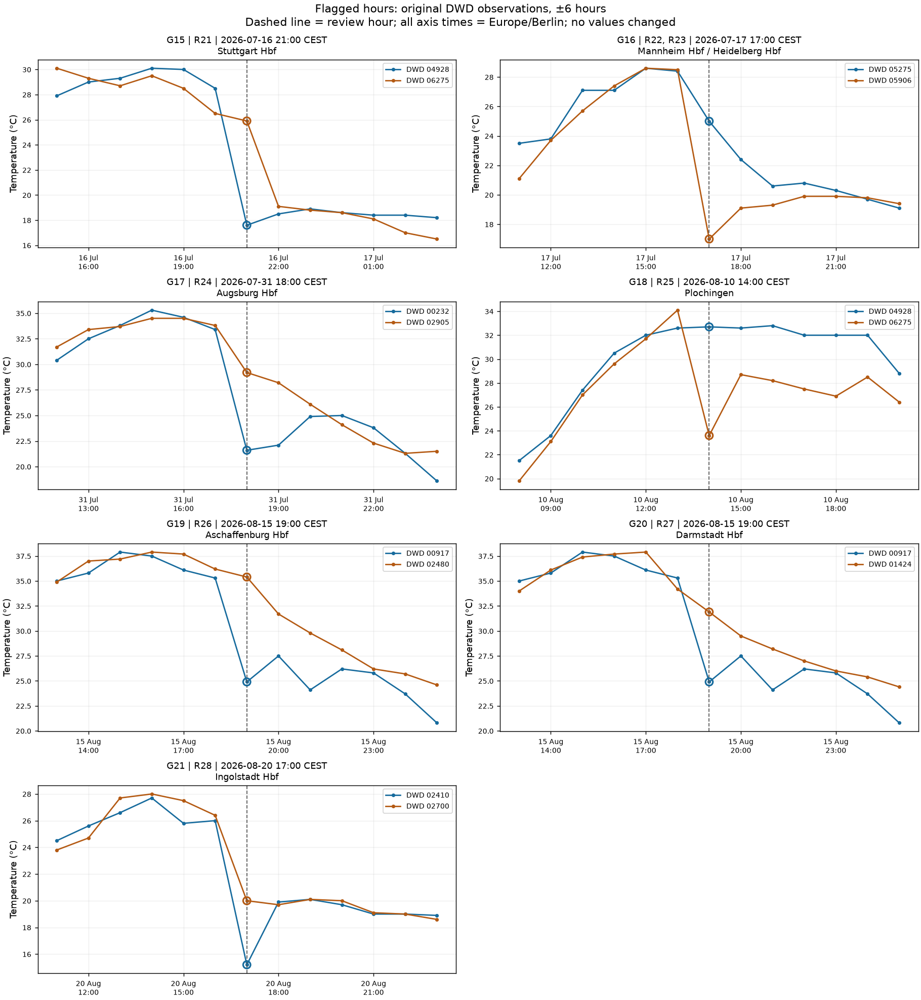

# Temperature review candidates: locations and hourly context

Status: **original screening snapshot, before manual review**. [Applied decisions and final report](../temperature_report.md) are documented separately.

The inventory contains 17 hourly-change flags and 12 primary/backup-difference flags; 1 record has both flags. These are screening candidates, not confirmed measurement errors.

## Locate an observation

- `R` identifies a railway-station record in this fixed review snapshot; `G` identifies its paired-station chart.
- Table times use **Europe/Berlin**, with CET/CEST shown explicitly. Exact UTC keys are retained in the source lookup below and in `review_context.json`.
- The temperature sequence is **previous hour → selected hour → next hour** for the railway station. All temperatures and differences are in °C.
- `Main / backup` gives the mapped DWD station IDs, not railway EVA IDs. The backup column is a comparison observation; it has not replaced a present primary value.
- In this snapshot, all 28 selected observations come from the primary DWD station, and no flagged hourly change coincides with a source switch.
- Values and charts here preserve the pre-review evidence. Applied source choices are documented in the final report.

## All review records

| Record / chart | Railway station | German local time | Main / backup DWD | Previous → selected → next | Backup at review hour | Review trigger |
|---|---|---|---|---:|---:|---|
| R01 / G01 | Stuttgart Hbf | 2024-07-21 16:00 CEST | 04928 / 06275 | 26.8 → 18.8 → 21.2 | 29.2 | Pair gap 10.4 °C |
| R02 / G01 | Plochingen | 2024-07-21 16:00 CEST | 06275 / 04928 | 27.8 → 29.2 → 23.3 | 18.8 | Pair gap 10.4 °C |
| R03 / G02 | Fürth (Bay) Hbf | 2024-08-01 16:00 CEST | 03668 / 03667 | 28.5 → 18.4 → 19.2 | 18.4 | Drop 10.1 °C / 1 h |
| R04 / G02 | Nürnberg Hbf | 2024-08-01 16:00 CEST | 03668 / 03667 | 28.5 → 18.4 → 19.2 | 18.4 | Drop 10.1 °C / 1 h |
| R05 / G03 | Ulm Hbf | 2024-08-14 19:00 CEST | 15444 / 06275 | 26.7 → 15.5 → 16.5 | 27.3 | Drop 11.2 °C / 1 h; Pair gap 11.8 °C |
| R06 / G04 | Ulm Hbf | 2024-10-25 14:00 CEST | 15444 / 06275 | 9.3 → 9.4 → 10.3 | 19.7 | Pair gap 10.3 °C |
| R07 / G05 | Ulm Hbf | 2025-01-23 05:00 CET | 15444 / 06275 | -0.2 → 0.3 → 1.3 | 10.8 | Pair gap 10.5 °C |
| R08 / G06 | Mannheim Hbf | 2025-05-31 18:00 CEST | 05906 / 05275 | 28.6 → 17.5 → 18.0 | 22.8 | Drop 11.1 °C / 1 h |
| R09 / G06 | Heidelberg Hbf | 2025-05-31 18:00 CEST | 05906 / 05275 | 28.6 → 17.5 → 18.0 | 22.8 | Drop 11.1 °C / 1 h |
| R10 / G07 | Ulm Hbf | 2025-08-16 17:00 CEST | 15444 / 06275 | 24.0 → 18.1 → 16.4 | 28.8 | Pair gap 10.7 °C |
| R11 / G08 | Ulm Hbf | 2025-08-16 18:00 CEST | 15444 / 06275 | 18.1 → 16.4 → 16.5 | 28.8 | Pair gap 12.4 °C |
| R12 / G09 | Ulm Hbf | 2025-08-16 19:00 CEST | 15444 / 06275 | 16.4 → 16.5 → 16.2 | 27.6 | Pair gap 11.1 °C |
| R13 / G10 | München Hbf | 2026-05-31 15:00 CEST | 03379 / 07431 | 29.6 → 18.8 → 18.9 | 26.5 | Drop 10.8 °C / 1 h |
| R14 / G10 | München-Pasing | 2026-05-31 15:00 CEST | 03379 / 07431 | 29.6 → 18.8 → 18.9 | 26.5 | Drop 10.8 °C / 1 h |
| R15 / G11 | Augsburg Hbf | 2026-06-02 19:00 CEST | 00232 / 02905 | 24.3 → 13.8 → 14.7 | 15.6 | Drop 10.5 °C / 1 h |
| R16 / G12 | München Hbf | 2026-06-21 14:00 CEST | 03379 / 07431 | 31.9 → 31.6 → 28.9 | 20.7 | Pair gap 10.9 °C |
| R17 / G12 | München-Pasing | 2026-06-21 14:00 CEST | 03379 / 07431 | 31.9 → 31.6 → 28.9 | 20.7 | Pair gap 10.9 °C |
| R18 / G13 | Bamberg | 2026-06-21 16:00 CEST | 00282 / 03668 | 34.0 → 32.4 → 27.5 | 20.6 | Pair gap 11.8 °C |
| R19 / G14 | Fürth (Bay) Hbf | 2026-07-14 18:00 CEST | 03668 / 03667 | 29.4 → 17.2 → 15.4 | 22.9 | Drop 12.2 °C / 1 h |
| R20 / G14 | Nürnberg Hbf | 2026-07-14 18:00 CEST | 03668 / 03667 | 29.4 → 17.2 → 15.4 | 22.9 | Drop 12.2 °C / 1 h |
| R21 / G15 | Stuttgart Hbf | 2026-07-16 21:00 CEST | 04928 / 06275 | 28.5 → 17.6 → 18.5 | 25.9 | Drop 10.9 °C / 1 h |
| R22 / G16 | Mannheim Hbf | 2026-07-17 17:00 CEST | 05906 / 05275 | 28.5 → 17.0 → 19.1 | 25.0 | Drop 11.5 °C / 1 h |
| R23 / G16 | Heidelberg Hbf | 2026-07-17 17:00 CEST | 05906 / 05275 | 28.5 → 17.0 → 19.1 | 25.0 | Drop 11.5 °C / 1 h |
| R24 / G17 | Augsburg Hbf | 2026-07-31 18:00 CEST | 00232 / 02905 | 33.4 → 21.6 → 22.1 | 29.2 | Drop 11.8 °C / 1 h |
| R25 / G18 | Plochingen | 2026-08-10 14:00 CEST | 06275 / 04928 | 34.1 → 23.6 → 28.7 | 32.7 | Drop 10.5 °C / 1 h |
| R26 / G19 | Aschaffenburg Hbf | 2026-08-15 19:00 CEST | 02480 / 00917 | 36.2 → 35.4 → 31.7 | 24.9 | Pair gap 10.5 °C |
| R27 / G20 | Darmstadt Hbf | 2026-08-15 19:00 CEST | 00917 / 01424 | 35.3 → 24.9 → 27.5 | 31.9 | Drop 10.4 °C / 1 h |
| R28 / G21 | Ingolstadt Hbf | 2026-08-20 17:00 CEST | 02410 / 02700 | 26.0 → 15.2 → 19.9 | 20.0 | Drop 10.8 °C / 1 h |

## Shared observations and comparisons

The 28 railway records use 22 distinct selected DWD station-hour observations and 21 distinct station-pair/hour comparisons. Shared observations should be reviewed together; record counts are not counts of independent weather events.

- **G01:** R01 — Stuttgart Hbf; R02 — Plochingen.
- **G02:** R03 — Fürth (Bay) Hbf; R04 — Nürnberg Hbf.
- **G06:** R08 — Mannheim Hbf; R09 — Heidelberg Hbf.
- **G10:** R13 — München Hbf; R14 — München-Pasing.
- **G12:** R16 — München Hbf; R17 — München-Pasing.
- **G14:** R19 — Fürth (Bay) Hbf; R20 — Nürnberg Hbf.
- **G16:** R22 — Mannheim Hbf; R23 — Heidelberg Hbf.

## Hourly context charts

Each chart shows the two original DWD station series for six hours before and after the review hour. Legend IDs identify the stations; primary/backup roles are given in the record table. A pair can serve railway stations in opposite roles. Missing observations remain gaps.

### G01–G07

### G08–G14

### G15–G21

## Exact source lookup

Line numbers below refer to the product TXT **inside the ZIP**, counting the header as line 1. Archive hashes, station IDs, UTC timestamps, raw temperature tokens and quality codes were checked against the exported observations. Complete ZIP/member filenames, source station names/distances and the ±6-hour context are retained in [review_context.json](review_context.json).

| Record | UTC hour | DWD ID | Archive | Product TXT line |
|---|---|---|---|---:|
| R01 | 2024-07-21 14:00 | 04928 | historical | 411719 |
| R02 | 2024-07-21 14:00 | 06275 | historical | 175803 |
| R03 | 2024-08-01 14:00 | 03668 | historical | 607647 |
| R04 | 2024-08-01 14:00 | 03668 | historical | 607647 |
| R05 | 2024-08-14 17:00 | 15444 | historical | 87190 |
| R06 | 2024-10-25 12:00 | 15444 | historical | 88913 |
| R07 | 2025-01-23 04:00 | 15444 | historical | 91065 |
| R08 | 2025-05-31 16:00 | 05906 | historical | 678534 |
| R09 | 2025-05-31 16:00 | 05906 | historical | 678534 |
| R10 | 2025-08-16 15:00 | 15444 | historical | 95996 |
| R11 | 2025-08-16 16:00 | 15444 | historical | 95997 |
| R12 | 2025-08-16 17:00 | 15444 | historical | 95998 |
| R13 | 2026-05-31 13:00 | 03379 | recent | 9975 |
| R14 | 2026-05-31 13:00 | 03379 | recent | 9975 |
| R15 | 2026-06-02 17:00 | 00232 | recent | 10027 |
| R16 | 2026-06-21 12:00 | 03379 | recent | 10478 |
| R17 | 2026-06-21 12:00 | 03379 | recent | 10478 |
| R18 | 2026-06-21 14:00 | 00282 | recent | 10314 |
| R19 | 2026-07-14 16:00 | 03668 | recent | 11034 |
| R20 | 2026-07-14 16:00 | 03668 | recent | 11034 |
| R21 | 2026-07-16 19:00 | 04928 | recent | 11085 |
| R22 | 2026-07-17 15:00 | 05906 | recent | 11105 |
| R23 | 2026-07-17 15:00 | 05906 | recent | 11105 |
| R24 | 2026-07-31 16:00 | 00232 | recent | 11442 |
| R25 | 2026-08-10 12:00 | 06275 | recent | 11678 |
| R26 | 2026-08-15 17:00 | 02480 | recent | 11803 |
| R27 | 2026-08-15 17:00 | 00917 | recent | 11032 |
| R28 | 2026-08-20 15:00 | 02410 | recent | 11910 |

## Review decisions

Inspect the context and source metadata before deciding to retain, remove or replace a record. The context JSON preserves its pre-review Pending labels. Applied decisions are recorded in [manual_review_decisions.json](manual_review_decisions.json) and the [final report](../temperature_report.md).

Inputs: [railway initial dataset](../../../observations/railway_temperature_initial.parquet), [DWD source observations](../../../observations/temperature.parquet), [issue inventory](issue_inventory.csv), and [final report](../temperature_report.md).
